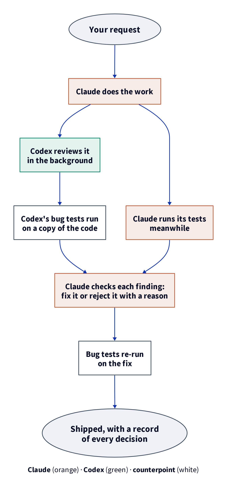
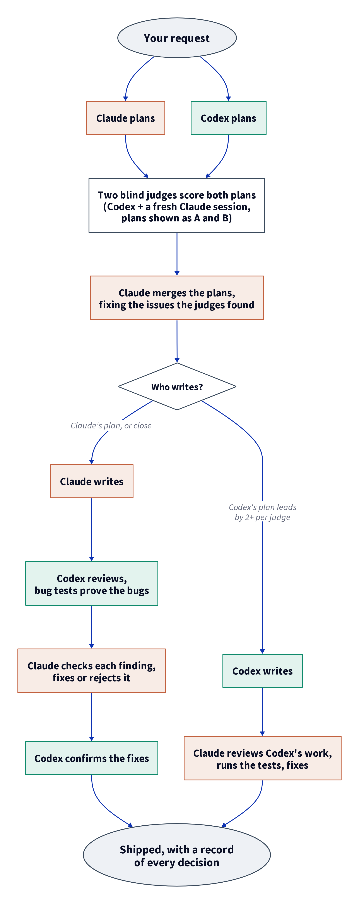

<div align="center">

<table>
<tr>
<td align="center"><br/><sub><b>Claude</b></sub></td>
<td align="center"><h2>+</h2></td>
<td align="center"><br/><sub><b>OpenAI Codex</b></sub></td>
</tr>
</table>

# counterpoint

### Use Claude and Codex together, in Claude Code.

Two models from two labs catch more mistakes than one.<br/>
counterpoint makes them work as a team on every task, using the subscriptions you already have.


</div>

## Why two models

Every model has blind spots, and a model reviewing its own work shares them. A model trained by another lab makes different mistakes, so it spots the ones yours missed.

There is a catch. A controlled study on 116 coding tasks found that Codex reviewing Claude's code **lowered** the success rate (91.4% down to 82.8%) when its advice was applied without checking. Claude reviewing Codex raised it (71.6% up to 89.7%).[^1] A second opinion helps only if someone checks it.

counterpoint is built around that result:

| | |
|---|---|
| **Claude does the work** | You keep working in Claude Code as usual. |
| **Codex reviews it** | In the background, with a precise location and evidence for every problem it raises. |
| **Serious bugs come with a test** | Codex writes a small test that fails while the bug is there. counterpoint runs it in seconds, so a claim becomes a fact or a false alarm. |
| **Claude has the last word** | It checks every finding against the code and its tests, then fixes it or rejects it with a reason. Nothing is applied blindly. |
| **It learns your project** | Rejected findings are remembered, so Codex stops raising them again. |

It runs on the Claude and ChatGPT subscriptions you already pay for.

## Quick start

You need [Claude Code](https://claude.com/claude-code) and the Codex CLI signed in with ChatGPT (`npm i -g @openai/codex`, then `codex login`).

```bash
git clone https://github.com/tns-research/counterpoint
mkdir -p ~/.claude/skills
ln -s "$PWD/counterpoint/skills/counterpoint" ~/.claude/skills/counterpoint
counterpoint/skills/counterpoint/bin/counterpoint doctor   # checks your setup
```

Then, in Claude Code:

```text
/counterpoint fix the timeout parsing in config.sh
```

Claude does the task, Codex reviews it, and Claude reports what the review changed.

## What a review looks like

```text
=== counterpoint review (ok, 42s)
verdict: fix  |  The script misses the warning for empty values and reads leading zeroes as octal.

- F1 [major/correctness] timeout-config.sh:10
  problem:  Arithmetic expansion reads leading zeroes as octal.
  evidence: $((timeout_seconds)) prints 8 for JOB_TIMEOUT=0010; the request requires 10.
  fix:      Strip leading zeroes from the validated string before any arithmetic.

repro F1: REPRODUCED (its test fails on the reviewed code)
```

Claude fixes it, the test is re-run, and the turn closes with a one-line record of each decision:

```text
F1 applied (bug test now passes)
F2 rejected: the cited input is rejected earlier by parse_args (line 40)
```

## How it works

There are two depths.

### Small (the default): Claude writes, Codex reviews

`/counterpoint <task>`. For everyday changes, about 20 to 50 seconds of Codex time.

<div align="center">

</div>

### Full: two plans, two blind judges, the better author writes

`/counterpoint full <task>`. For work where a wrong approach is expensive. Both models act as authors here, and either one can end up writing.

<div align="center">

</div>

1. **Two independent plans.** Codex and Claude each plan the task without seeing the other's plan.
2. **Two blind judges.** Codex and a fresh Claude session (no tools, no memory of writing either plan) score both plans on five criteria: constraints covered, correctness, specificity, risks handled, and real insight. The plans are shown as A and B in a random order, so neither judge knows which is whose. A model tends to prefer its own style, and two judges from two labs cancel that out.
3. **Merge.** Claude merges the two plans, starting from the stronger one and fixing the issues the judges found.
4. **The better author writes.** If Codex's plan leads by 2 points or more per judge, Codex writes and Claude reviews its work, the direction the study found strongest. Otherwise Claude writes and Codex reviews, with bug tests.
5. **Codex rechecks the fixes** in its own review thread, in seconds. The turn cannot close without this recheck. If Codex says a fix did not work, Claude fixes it again and rechecks, or records why Codex is wrong.

About 6 minutes in our end-to-end run, most of it the review.

In both modes, the turn cannot close until every finding has a decision, and a bug proven by a test cannot be marked fixed while its test still fails. If Codex is down, the work can still ship, and the record says it went unreviewed.

## Speed

Measured with the real Codex on 2026-11-03, small runs on the same task with and without bug tests.

| | Time |
|---|---|
| Small review, bug tests off | 22 to 31 s |
| Small review, bug tests on (3 bugs found, 3 tests written) | 40 to 47 s |
| Running the bug tests | about 1 s |
| Full, a complete Claude Code task end to end (an atomic file update, bash) | 349 s: plans 35 s, two blind judges 48 s, review 124 s, recheck 11 s. Task passed its checker; 2 real bugs fixed |

Most of the gain comes from running Codex in the background while Claude keeps working, handing it the material directly so it does not explore the repo, and reusing its review thread for the final check. `--no-repro` skips the bug tests (about 16 s saved when it finds bugs). `COUNTERPOINT_FAST=1` asks for Codex's faster priority tier, which uses more of your plan.

## Reference

<details>
<summary><b>Always-on mode (hooks)</b></summary>

To run every turn through counterpoint without typing `/counterpoint`, register the two hooks in `~/.claude/settings.json`:

```json
{
  "hooks": {
    "UserPromptSubmit": [{ "hooks": [{ "type": "command", "command": "/abs/path/counterpoint/skills/counterpoint/hooks/prompt.sh" }] }],
    "Stop": [{ "hooks": [{ "type": "command", "command": "/abs/path/counterpoint/skills/counterpoint/hooks/stop.sh" }] }]
  }
}
```

Then switch with `counterpoint mode small`, `full` or `off`. With the mode `off`, nothing changes.

When the mode is on, the first attempt to end a turn that was neither reviewed nor skipped is refused. A second attempt goes through and is logged in `~/.counterpoint/escapes.log`, so a session can never get stuck.

</details>

<details>
<summary><b>Commands</b></summary>

Claude runs these for you. They also work on their own (optionally link `bin/counterpoint` into your `PATH`).

| Command | What it does |
|---|---|
| `start small` or `start full` | open a turn for a new task, at that depth |
| `review --diff` or `--draft FILE` | Codex reviews the work. `--brief`/`--ask` give it the request, `--context` the constraints, `--plan` the agreed plan, `--bg` runs it in the background |
| `plan --brief FILE` | Codex plans independently (full mode) |
| `compare --mine FILE --brief FILE` | two blind judges (Codex and a fresh Claude session) score both plans and name who writes (full mode) |
| `produce --brief FILE [--write DIR]` | Codex writes the deliverable (full mode, when its plan is better) |
| `wait` | collect a background run and print it |
| `verify` | re-run the bug tests on the fixed code |
| `recheck --diff --ledger FILE` | Codex confirms the fixes in its own thread (full mode) |
| `done --final FILE --ledger FILE` | close the turn (full mode: `--keep-producer "why"` if Claude wrote although Codex's plan won) |
| `skip "reason"` | close a turn with nothing to review (a question, a discussion) |
| `status` | the current turn's Codex runs |
| `log` | your last turns: findings raised, applied, rejected, Codex time |
| `stats [--all]` | how often each category of finding held up in this project |
| `forget` | clear this project's finding history |
| `doctor` | check the setup |
| `gc [DAYS]` | delete turn records older than 30 days |

Each task starts with `counterpoint start small|full`, which Claude runs for you. Inside Claude Code, every later command belongs to that turn of its own session, so tasks and parallel sessions never mix. Outside it, pass `--turn ID`.

`done` refuses to close when a finding has no decision, a rejection has no reason, a reproduced bug is marked fixed but its test fails or was never re-run, the latest review failed or is still running, a fix Codex's recheck disputes is still marked applied, or, in full mode, the plans were never compared, the chosen author did not write, or the fixes were never rechecked. `--unreviewed "<why>"` ships anyway and says so in the record.

</details>

<details>
<summary><b>Configuration</b></summary>

| Variable | Default | |
|---|---|---|
| `COUNTERPOINT_MODEL` | Codex's default | any model your Codex lists |
| `COUNTERPOINT_EFFORT` | per phase | force one reasoning effort for every call (defaults: review `medium`, `high` in full mode; plan and compare `medium`; recheck `low`) |
| `COUNTERPOINT_FAST` | `0` | `1` requests the priority (fast) tier |
| `COUNTERPOINT_CODEX_MARGIN` | `2` | points per judge by which Codex's plan must lead for Codex to write |
| `COUNTERPOINT_CLAUDE_JUDGE` | `1` | `0` leaves the plan comparison to Codex alone |
| `COUNTERPOINT_CLAUDE_JUDGE_MODEL` | Claude Code's default | model for the blind Claude judge |
| `COUNTERPOINT_CODEX_TIMEOUT` | `600` | seconds per Codex call; a timeout is never retried |
| `COUNTERPOINT_CODEX_RETRIES` | `1` | retries after a transient failure |
| `COUNTERPOINT_CODEX_ENV_PASSTHROUGH` | | extra variable names Codex and the bug tests may see |
| `COUNTERPOINT_REPRO` | `1` | `0` turns bug tests off (same as `--no-repro`) |
| `COUNTERPOINT_REPRO_TIMEOUT` | `30` | seconds per bug test |
| `COUNTERPOINT_MEMORY` | `1` | `0` stops showing Codex past rejections (same as `--no-memory`) |
| `COUNTERPOINT_MEMORY_ITEMS` | `20` | how many past rejections a review is shown |
| `COUNTERPOINT_HOME` | `~/.counterpoint` | where turns, the log and the project history live |

</details>

<details>
<summary><b>Security and privacy</b></summary>

- Codex starts with an empty environment (only `HOME`, `PATH`, the locale and `CODEX_HOME`). Your exported keys and tokens never reach it unless you name them in the passthrough.
- It runs with `--ignore-user-config`, so MCP servers from your Codex config cannot be called during a review.
- Review, plan and recheck are read-only. Only `produce --write DIR` lets Codex edit files, and where Codex's own sandbox cannot start (some containers) it refuses unless you pass `--allow-bypass`.
- Bug tests are code written by Codex, so they always run in a throwaway copy of your project (the files git tracks, with `node_modules`, `.venv`, `venv` and `vendor` linked in), with the same empty environment and a 30 s limit. They have no sandbox beyond that: use `--no-repro` where running reviewer-written tests is not acceptable.
- The blind Claude judge in full mode runs as `claude -p` with no tools, no MCP servers, no settings or hooks, and no session saved. It only reads the two plans and the request.
- The project history stays on your machine, in `~/.counterpoint/projects/`, outside the repo.
- Codex sees what you hand it: the request, the context files and the work. Keep secrets out of them.

</details>

<details>
<summary><b>Requirements and platforms</b></summary>

Linux or macOS, including a stock Mac (bash 3.2, BSD tools, no `timeout`). Full mode's second judge uses the `claude` CLI that comes with Claude Code. Bug tests, project memory and plan scoring need `python3` or `jq` (macOS 15 ships `jq`); without either they switch themselves off. `counterpoint doctor` shows what your machine will do.

</details>

<details>
<summary><b>How it is tested</b></summary>

- About 200 offline checks run against a fake `codex` and a fake `claude`, so they cost nothing: every command, the decision rules, the bug tests (reproduced, not reproduced, broken, slow, secrets kept out, real project untouched), the memory, the plan comparison and its gates, the hooks, timeouts and retries. `tests/run-all.sh` runs them under your bash and again under bash 3.2 as shipped on macOS.
- A portability check rejects GNU-only flags and bash 4 syntax.
- Live runs with the real Codex and Claude Code, in small and full mode, on tasks with an automatic checker. The speed numbers above come from them. counterpoint also reviewed its own code before this release: Codex found and proved 3 real bugs, which were fixed.

</details>

<details>
<summary><b>Repo layout</b></summary>

```
skills/counterpoint/
  SKILL.md          the loop, as Claude follows it (one page)
  bin/counterpoint  the CLI: every command above
  lib/core.sh       time limits, retries, empty environment, sandbox check, findings as data
  prompts/          instructions for the reviewer, planner, recheck, producer and bug tests
  schemas/          the JSON shapes Codex must answer in
  hooks/            prompt.sh (starts a turn), stop.sh (one refusal, then a logged escape)
tests/              offline suite behind a fake codex; run-all.sh replays it under bash 3.2
```

</details>

<details>
<summary><b>Upgrading from v2</b></summary>

v3 replaces the nine `scripts/counterpoint-*.sh` commands with one `bin/counterpoint`, free-text critiques with structured findings and a decision record, and the plan scoring and separate plan-review call with `compare`, where two blind judges (Codex and a fresh Claude session) pick who writes. It adds bug tests, project memory and a required recheck of the fixes in full mode. Point your hooks at `hooks/prompt.sh` and `hooks/stop.sh`. Old runs under `~/.counterpoint/runs/` are left untouched.

</details>

## License

[MIT](./LICENSE). Copyright (c) 2026 tns-research.

The name comes from music: independent voices that sound better together.

[^1]: Xiang et al., *Cross-Model LLM Code Review: Should you use Claude to review Codex or vice versa?*, Agentic SE @ KDD'26, [arXiv:2607.21656](https://arxiv.org/abs/2607.21656).
