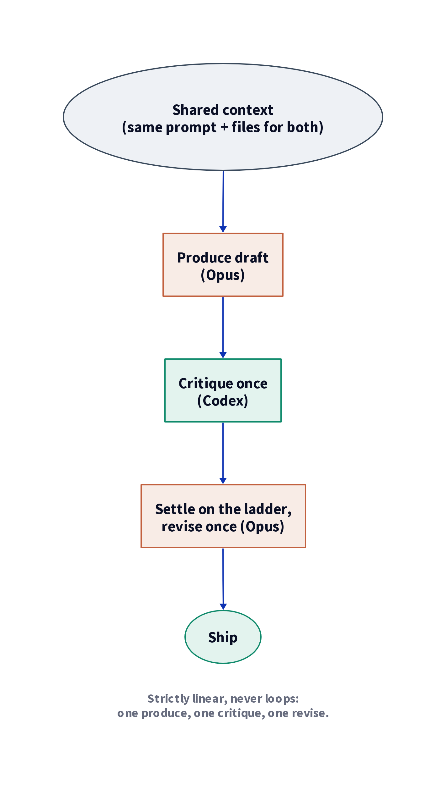
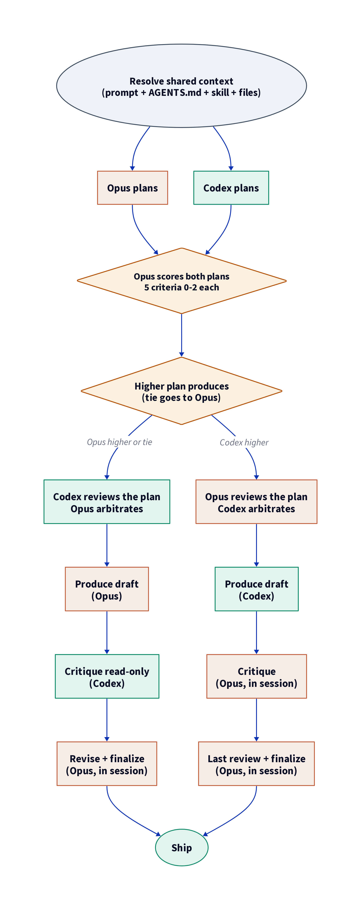
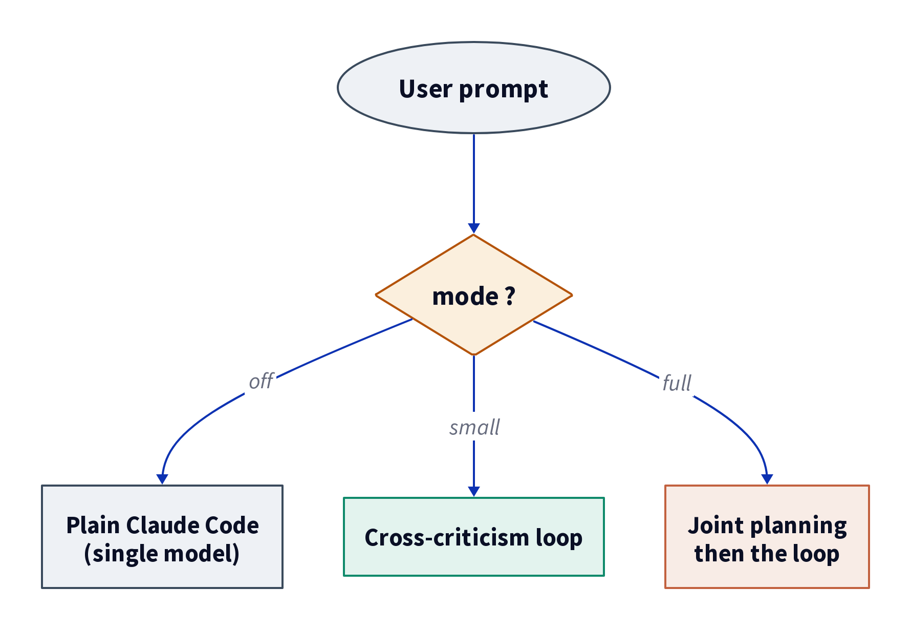

<div align="center">

<table>
<tr>
<td align="center"><br/><sub><b>Claude Opus</b></sub></td>
<td align="center"><h2>&times;</h2></td>
<td align="center"><br/><sub><b>OpenAI Codex</b></sub></td>
</tr>
</table>

# 🎼 counterpoint

**Two frontier models, from two labs, reviewing each other before anything ships.**

*Named for the musical form: independent voices, interdependent by design.*


</div>

Tired of asking Codex what it thinks of Claude's plan? 🥱 Of copy-pasting a draft
from one model into the other to ask "where does this fall apart?", reading the
critique, and pasting it back, every single time? counterpoint does that handoff
for you, automatically, on every turn inside Claude Code. You keep driving Claude
Code exactly as you do today; your two AI subscriptions just start talking to each
other instead of you playing telephone between them.

Two flagship models from two different labs review each other's work before
anything ships. Claude Opus (the orchestrator) and OpenAI Codex (reached through
the `codex exec` CLI on the ChatGPT subscription) take the roles of producer and
critic, so each turn gets a second, model-diverse pass. Two models with
different failure modes catch each other's blind spots.

> [!IMPORTANT]
> **counterpoint needs two subscriptions.** 🔌 It runs Claude Opus (on
> your Claude plan) *and* OpenAI Codex (on your ChatGPT plan) side by side. There
> is no metered-API path and no OpenAI API key: just the two apps you already pay
> for, both signed in. With only one of them, the loop cannot run.

> [!NOTE]
> **What it costs you: time and both subscriptions. Zero metered-API dollars.** 💸
> - ⏱️ **Time:** expect a turn several minutes longer than plain Claude Code.
>   Each `codex exec` call is a full multi-minute run: **small** mode adds one,
>   **full** mode adds two to three.
> - 🔋 **Usage:** the baseline 1× is your Claude (Opus) plan; the extra passes
>   bill against your ChatGPT (Codex) plan, so every loop turn spends both at once.
> - 🟢 **Metered API:** **$0**. No token meter, no surprise bill. Both models run
>   on flat subscriptions.

## 🎯 What a second model actually catches

A single model tends to miss its own blind spots: when it grades its own draft,
the critique runs on the same weights that wrote it, so it inherits the same
failure modes. A model from a different lab was trained differently and fails
differently, so it tends to catch what the first one is structurally likely to
miss.

Concretely, in one live run the producer drafted a data audit and called a metric
"weak". The critic flagged it: the figure was a misleading average across pages,
and the page that actually mattered was a top result. A plausible, confident,
wrong conclusion, caught by the second model before it shipped.

This works because of **context parity**: before it critiques, the second model
is handed the same prompt, the same resolved AGENTS.md / skill / files, and the
producer's full output, so it grades against the real constraints instead of a
summary of them. A constraint the critic never read is a constraint it cannot
check.

## ⚙️ How it works

One turn, one bounded producer-critic exchange, then it ships the revised result.
It is a fixed choreography with a predictable cost and latency rather than an open
"loop until success".

**Small mode is strictly linear and never loops**: Opus produces one draft, Codex
critiques it once, Opus revises once and ships, even for code with a hard
verifier. The one step that may repeat is a capped mini-loop (2 to 3 rounds), and
it is **full mode only**, and only when a hard verifier (tests, build, types)
gives an objective stop signal.

<div align="center">



</div>

Full mode prepends a joint planning front-end: both models plan independently,
the divergence between their plans is itself the audit signal, and only the
reconciled plan feeds the produce-critique-revise pipeline above, where full mode
adds the capped mini-loop for code.

In full mode the arbitration step decides who produces by **scoring the two
plans**. Each plan is scored on a fixed five-criterion rubric (constraint
coverage, critical-path correctness, load-bearing specificity, off-path risk
handling, decision-level information gain), 0 to 2 each, and **Opus scores both**
(one cited line per cell, so padding is visible). The author of the higher total
produces while the other critiques, with any margin counting: a one-point lead
already routes production, and only an exact tie goes to Opus, since the
live in-session process takes the operational edge on a dead heat. The aim is
**equal opportunity rather than a forced 50/50 split**: Codex's plan can win
production whenever it is clearly better, and Codex shapes every turn anyway
through its plan, its review of the reconciled plan, and its review of the
output. Production is decided on plan score alone, with **no capability carve-out
and no forced quota**: when Codex wins it produces the whole deliverable, code
included, through `codex-produce.sh --write` with full authorizations, exactly as
Opus would. The authoritative routing rule lives in one place, `SKILL.md` step
F2. After the two plans are reconciled into one, and before any of the
deliverable is written, the model that did *not* win production reviews the
reconciled plan and the producer arbitrates that review, so a step invented
during the merge cannot reach production unread. The roles are symmetric, so a
full turn runs one of two paths, and in Config A the live Opus always does the
last pass in the session before anything ships:

<div align="center">



</div>

Disagreements settle on a verification ladder:

1. **Hard verifier** (code only): tests, build, types, linter. A flagged issue
   that breaks one of these must be fixed; no opinion overrides a failing check.
2. **Constraint-adherence** (universal): does the draft satisfy each written
   constraint in the brief, AGENTS.md, and the active skill? This is the
   semi-objective arbiter for prose, research, and marketing, and it doubles as
   the mechanism that forces both models to actually follow those instructions.
3. **Reasoned critique** (fallback): a taste-only issue goes to the finalizer's
   judgment, with a cited reason. Reliance on this rung is minimized.

## 🎚️ The three modes

The behavior is a single three-position toggle stored in `~/.counterpoint/mode`:

<div align="center">



</div>

| Mode | What runs | Rough cost |
|------|-----------|------------|
| 🔴 **off** | plain single-model Claude Code (the loop is dormant) | 1× |
| 🟡 **small** | cross-criticism: produce, critique with context parity, revise, deliver | ~1.5× |
| 🟢 **full** | small, plus a joint planning front-end: both models plan, Opus scores the two plans to assign the producer, they reconcile into one agreed plan, the non-producer reviews that plan and the producer arbitrates it, then production runs | ~2×+ |

The multipliers are rough. They track the extra model passes a turn adds, one
cross-critique for small, plus the joint plan and plan review for full, rather
than a benchmark; a turn is also several minutes longer because each `codex exec`
call is a full multi-minute run. The baseline 1× is your Claude (Opus) usage; the
extra passes run on Codex against your ChatGPT subscription, so every loop turn
spends both plans at once.

Pick **full** for high-stakes turns where starting from a bad plan is expensive
(architecture, a long document, a multi-step refactor). Pick **small** for an
ordinary turn where one cross-critique pass is enough. Leave it **off** to get
ordinary Claude Code back.

## 🚀 Two ways to invoke it

**Manual, per turn.** Type `/counterpoint` (small) or `/counterpoint full` in
Claude Code, followed by the task. Nothing global changes; only that one turn
runs the loop.

**Always-on, via the toggle.** Set the mode once and every turn runs the loop at
that depth until you switch it back, with no slash command typed:

```bash
skills/counterpoint/scripts/counterpoint-mode.sh small   # turn it on (cross-criticism)
skills/counterpoint/scripts/counterpoint-mode.sh full    # joint planning + cross-criticism
skills/counterpoint/scripts/counterpoint-mode.sh status  # show current mode
skills/counterpoint/scripts/counterpoint-mode.sh off     # back to plain Claude Code
```

A `UserPromptSubmit` hook (`skills/counterpoint/hooks/counterpoint-hook.sh`)
reads the toggle on every prompt. When the mode is `off` (or no file exists) and
no `/counterpoint` is typed, the hook stays silent and the turn is ordinary
single-model Claude Code. When it is `small` or `full` the hook appends an
instruction block to the turn, telling the orchestrator to run the skill at that
depth. When you type `/counterpoint` by hand it does not append that block (the
slash command already loads the skill), so the manual and always-on paths never
double-fire.

The critical steps run as scripts that each write a per-turn artifact: the
critique, and in full mode the joint plan and the plan review. A second `Stop`
hook (`hooks/counterpoint-stop-hook.sh`) then refuses to end the turn until those
artifacts exist, so the orchestrator cannot skip the second opinion and claim it
happened. The toggle is the single source of truth: the `Stop` hook re-reads it
live every turn, so nothing can go stale and contradict it. A manual
`/counterpoint` still runs the loop for that turn via the skill, and the `Stop`
hook backstop is armed by the toggle.

## 📦 Install

**Requirements:**

- 🔌 **Two active subscriptions.** counterpoint runs Claude Opus and OpenAI Codex
  side by side, so it draws on a Claude plan (for Opus) and a ChatGPT plan (for
  Codex) at once. Both must be signed in; there is no metered-API path.
- 💻 **Linux or macOS.** One shared codebase covers both, and macOS means a stock
  Mac: bash 3.2 at `/bin/bash`, BSD userland, no Homebrew coreutils. Nothing in
  the scripts uses bash-4 syntax or a GNU-only flag, and the time bound falls
  back to a shell watchdog where `timeout(1)` does not exist.
  `tests/portability.sh` holds that line, and `tests/run-all.sh` re-runs the whole
  suite under a bash 3.2 when it finds one. Windows is not supported (it would
  need WSL or a separate runtime).
- 🩺 **Not sure the machine is ready?** `skills/counterpoint/scripts/counterpoint-doctor.sh`
  reports the bash version, whether the time bound is enforced by `timeout(1)` or
  the watchdog, the Codex CLI and its model/effort, whether both hooks are wired,
  and how much the run archive is holding.
- 🤖 **Claude Code**, with this skill discoverable (symlink the skill into
  `~/.claude/skills/`, the repo stays the source of truth):
  ```bash
  ln -s "$PWD/skills/counterpoint" ~/.claude/skills/counterpoint
  ```
- 🧠 **Codex CLI** signed in on the ChatGPT subscription (`codex login`), so the
  consult calls cost subscription time and zero metered API tokens. Last tested
  with `codex-cli` 0.142.4.

For the always-on toggle and the enforcement backstop, register **both** hooks in
`~/.claude/settings.json` (the `UserPromptSubmit` hook arms and injects the loop;
the `Stop` hook is what refuses to end a turn that skipped it):

```json
{
  "hooks": {
    "UserPromptSubmit": [
      {
        "hooks": [
          {
            "type": "command",
            "command": "/absolute/path/to/counterpoint/skills/counterpoint/hooks/counterpoint-hook.sh"
          }
        ]
      }
    ],
    "Stop": [
      {
        "hooks": [
          {
            "type": "command",
            "command": "/absolute/path/to/counterpoint/skills/counterpoint/hooks/counterpoint-stop-hook.sh"
          }
        ]
      }
    ]
  }
}
```

With both hooks registered and the mode left at `off`, nothing changes until you
flip the toggle, so installing it is safe. ✅

## 🗂️ Repo layout

```
skills/counterpoint/
  SKILL.md                        the producer-critic pipeline (small + full)
  scripts/codex-consult.sh        one read-only Codex pass, prompt on stdin, MCP disabled
  scripts/codex-produce.sh        Codex in producer mode (text with MCP disabled, or --write DIR)
  scripts/counterpoint-plan.sh    full mode F1: the joint plan, enforced
  scripts/counterpoint-review.sh  full mode F3: the reconciled-plan review, enforced
  scripts/counterpoint-run.sh     the critique half, enforced (writes draft.md + log.txt)
  scripts/counterpoint-finalize.sh records the revised deliverable (writes result.md)
  scripts/counterpoint-mode.sh    the off/small/full toggle CLI
  hooks/counterpoint-hook.sh      the UserPromptSubmit hook: arms + injects
  hooks/counterpoint-stop-hook.sh the Stop hook: refuses to end until artifacts exist
tests/                            dependency-free regression tests for hooks and helpers
```

## ✅ Status

Working MVP. Both modes run, both invocation paths (manual slash command and
always-on hook) are wired, and each turn makes one or more real `codex exec`
calls on the ChatGPT subscription. The enforced loop has been run live and
hook-driven on real tasks: a full-mode data audit where both the joint plan and
the cross-model critique caught real defects, and a run with Codex as the
file-writing producer. A regression test pins small mode to its strictly-linear
shape. Expect a multi-minute turn, more in full mode because of the extra
planning pass. The CLI is the chosen surface; an MCP wrapper was considered and
dropped, since the CLI plus the `Stop` hook already enforces the loop.

## License

counterpoint is released under the [MIT License](./LICENSE). Copyright (c)
2026 tns-research.
